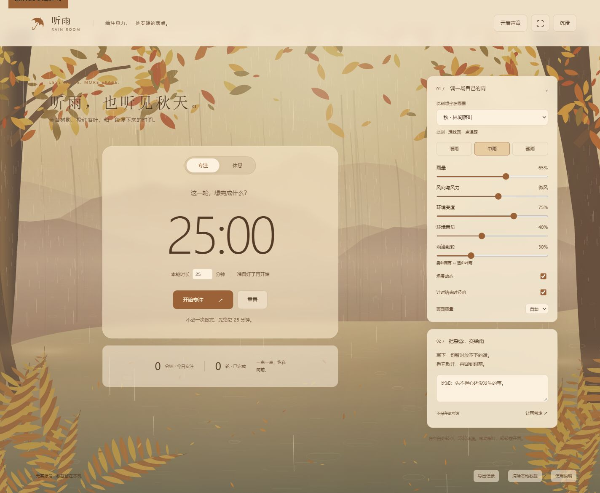

# 听雨 · Rain Room

**给注意力，一处安静的落点。** 一个本地优先的雨景专注工具：写下一件事，用一场雨陪你做完；休息时，把杂念交给雨。

[在线听雨](https://angie37958.github.io/rain-room/) · [GitHub 仓库](https://github.com/Angie37958/rain-room)

原生 JavaScript · Canvas 2D · Web Audio · 可安装与离线使用 · 零运行依赖 · MIT



[查看手机预览](./docs/images/mobile.jpg) · [验证记录](./docs/TESTING.md)

| 想要的氛围 | 场景 | 画面与声音 |
| --- | --- | --- |
| 想重新开始 | 樱花 · 想重新开始 | 粉白花枝、溪水、细雨与飘落花瓣 |
| 放慢一点 | 荷塘 · 想放慢一点 | 浮叶、水光与近处水滴 |
| 找回一点温暖 | 秋林 · 想找回一点温暖 | 金黄树影、橙红落叶与暖色水光 |
| 留点空白 | 冻湖 · 想留点空白 | 蓝白冰面、雪岸、缓慢落雪与合成风声 |
| 出去透透气 | 晴日 · 想出去透透气 | 阳光、白云、野花与实录太阳雨 |
| 安静待一会儿 | 窗边 · 想安静待一会儿 | 暗蓝窗外、摊开的书本、绵密隔窗雨声 |

[春季预览](./docs/images/spring.jpg) · [冻湖预览](./docs/images/winter.jpg) · [白天预览](./docs/images/day.jpg) · [窗边预览](./docs/images/window.jpg)。菜单先按春夏秋冬排列，再列出昼夜。心境提示只是氛围选择，不改变计时、任务或记录。旧版竹影庭院已暂时移除，其保存设置会安全回到秋林。

> 这是独立实现的雨景项目，灵感来自粒子雨景演示；没有使用原视频的代码、图片或音频。不接真实天气数据。

## 它能帮你做什么

- **开始眼前的一件事**：填写任务，设定 1–180 分钟专注或休息时段，支持暂停、继续与重置。
- **用声音隔开一点干扰**：本地打包的 CC0 实录雨声，三种雨景预设；轻响提醒需要先手动开启声音。
- **按季节与日夜选择**：樱花、荷塘、秋林、冻湖、晴日草地和夜晚窗边。六种场景统一使用 Canvas 分层插画；冻湖落雪、春日花瓣分别绘制；樱花溪畔可见春雨，晴日草地改为明亮太阳雨。冻湖不出现水波，保留柔和合成风声。窗边去掉台灯，改为摊开的书本，暖光来自画外。
- **让休息有个出口**：写下一句话，看它散开；文字不保存。移动指针拨开雨丝，轻点空白地面泛起涟漪。
- **温和地回顾**：今日完成分钟数与轮次，CSV 导出；仅完整完成的专注轮次计入，不记录任务历史。
- **按你的习惯使用**：偏好和当前计时保存到本机，支持沉浸、全屏、键盘、手机布局、低功耗与减少动态效果。

## 运行

安装 [Node.js](https://nodejs.org/) 20 或更高版本（推荐 22），下载本仓库后在项目文件夹运行：

```sh
npm run dev
```

打开终端显示的 `http://127.0.0.1:5173`。**不需要 npm install、不需要 API Key。** 本项目使用 ES Modules，请通过本地服务器打开，而不是直接双击 HTML。

Windows 可以直接双击 `start.cmd`，然后打开窗口里显示的网址。若当前环境只有 Node、没有 npm，也可以运行 `node scripts/serve.mjs`。

端口被占用时：

```sh
npm run dev -- --port 5174
```

### 检查与构建

```sh
npm run check
npm test
npm run build
npm run preview
```

构建只把页面、样式、模块和图标复制到 `dist/`。场景均由代码绘制，不加载背景图片。相对资源路径支持 GitHub Pages 的仓库子路径，无 CDN、外部字体或音频下载；服务启动后不需要互联网。尚未实现 PWA 离线安装。此前写实窗景已停用，也不进入构建；见 [历史素材说明](./docs/ASSETS.md)。

## 使用

1. 写下这一轮想做的事，选择时长，点击「开始专注」。
2. 按需开启环境声，调节雨雪密度、风、光与音量。
3. 完成一轮后，手动开始休息。不会自动连续开始下一轮。
4. 想暂时放下一句话时，在「把杂念，交给雨」里写下并释放。

| 操作 | 方式 |
| --- | --- |
| 开始 / 暂停计时 | 空格（输入框和按钮内不触发） |
| 进入 / 退出沉浸 | H，或右上角按钮 |
| 退出说明窗口 | Escape |
| 静态雨景 | 关闭「场景动态」；计时与声音仍可使用 |
| 省电 | 画面质量选「省电」；隐藏标签页自动停止画面绘制 |
| 备份 | 页脚「导出记录」，得到 CSV |
| 删除数据 | 页脚「清除本地数据」，确认后删除 |

## 计时与记录的边界

- 使用截止时间戳计算剩余时间，而不是逐秒相减。切换标签页、浏览器节流或设备休眠后恢复时会校准；后台提示音仍可能延迟。
- 打开页面期间完成的专注轮次只记一次。日期按该轮的截止时间及本机时区计算；未完成、重置和休息不计入。
- 刷新时，尚未到期的计时会恢复；已经到期的关闭页面会回到待开始状态，不补记专注时长。完整关闭页面后无法提醒。
- 依赖设备时钟，手动修改系统时间会影响倒计时。它不是考试、医疗或其他关键场景的可靠闹钟。
- 多标签页通过 storage 事件同步状态，建议一次使用一个标签页。浏览器禁用存储时可以临时使用，但无法保留记录。

## 隐私

应用没有登录、后端、分析追踪、定位或第三方资源请求。以下内容存于当前来源的浏览器 `localStorage`（键名 `rain-room:v2`）：

- 雨景、音量、动画和计时时长偏好；
- 当前任务和当前计时状态；
- 完成轮次的随机 ID、分钟数、日期与完成时间。

杂念文字只短暂存在页面内存中，不存储、不上传。CSV 只包含日期、分钟数和完成时间。声音状态不自动恢复，避免刷新后突然播放。浏览器清除站点数据、更换浏览器或网址后，记录不会迁移。

站点托管平台可能有独立的访问日志，属于其自身隐私政策范围。共享电脑上使用完毕后，可以清除本地数据。

## 发布到 GitHub / GitHub Pages

将**包含本 README、package.json、src 和 .github 的文件夹**作为仓库根目录上传。不要上传上级工作区、dist 或 .openai。本仓库已配置 GitHub Pages 自动部署。

1. 在 GitHub 新建仓库并上传源码，主分支推荐 `main`。
2. 仓库 **Settings → Pages → Build and deployment → Source** 选择 **GitHub Actions**。
3. 在 **Actions** 页选择 **Deploy GitHub Pages → Run workflow**。
4. 部署成功后，工作流会显示 Pages 地址。之后每次推送到 main 都会自动部署，也可以手动重新运行工作流。

普通 push / PR 会运行 CI 检查与测试。也可把 `dist/` 部署到其他静态托管服务。

## 项目结构

```text
index.html             语义结构与界面
src/
  app.js               交互、状态协调与记录导出
  timer.js             不依赖 DOM 的计时和统计逻辑
  storage.js           存储读取与偏好校验
  rain.js              雨丝、微光、水花、涟漪
  install.js           安装说明、离线准备与版本更新
  audio.js             实录雨声混音与结束提示音
  recordings.js        实录资源、场景混音与循环接缝处理
  rain-sound.js        冬季风底（保留早期合成实验）
  environment.js       缓存绘制的秋林、荷塘背景
  window-environment.js 统一插画风的书本、窗框与夜景
  seasonal-environments.js 樱花、草地与冻湖冰雪
  cool-environments.js 冬日远山与湖岸基础层
  scenes.js            场景与氛围文案、旧设置校验
  scene-themes.css     六种场景共用的配色变量
  style.css            响应式界面与无障碍样式
assets/                CC0 实录雨声与自绘 SVG 图标（旧窗景图片仅作历史素材保留）
manifest.webmanifest   应用名称、图标与安装范围
sw.js                  离线缓存与更新
scripts/               本地服务、检查与静态构建
test/                  Node.js 内置测试
.github/workflows/     CI 和手动 Pages 部署
```

## 摸一会儿雨

先点右上角“沉浸”（或按 H），留出整片雨景。秋林、荷塘与樱花溪边的水面可以轻点，细碎水光会从落点慢慢扩散；水面使用二维阻尼波模拟，不再绘制发亮的同心圆。水纹沿实际水面裁切，不会扩散到天空或草地。

用鼠标、触控笔或手指缓缓划过，指针会带起淡淡的露珠拖尾，雨帘与花瓣带着惯性缓慢让开，再慢慢合拢。更多春天的花瓣、冬天的雪花和窗边雨珠也会轻轻让开。关闭“场景动态”时不产生这些反馈；声音与计时照常工作。

## 安装到桌面或手机

发布到 GitHub Pages 后，在 Edge / Chrome 中打开站点，点击页面底部“安装听雨”，或使用地址栏的安装图标。安卓可选“安装应用”；iPhone / iPad 在 Safari 分享菜单中选择“添加到主屏幕”。安装版有独立图标与窗口。

首次联网打开，等底部显示“已备好离线雨声”，再断网使用。六个场景、两段实录和计时工具会一并缓存。浏览器清理存储可能移除缓存；关闭应用后不提供计时提醒。安装版本仍使用各设备自己的本地记录，不会同步电脑与手机。

有新版本时，底部出现“更新听雨”；点击后刷新应用。源码开发预览不启用离线缓存，避免旧版本干扰开发；`npm run build` 后使用 `npm run preview` 检查安装和离线功能。

## 后续方向

- 补充更多不同地点的授权实录雨声。
- 在真实设备上测量能耗、帧率，改进低端手机表现。
- 评估可选通知，保持明确的权限提示。
- 加入英文界面与更完整的辅助技术验证。

欢迎贡献，见 [CONTRIBUTING.md](./CONTRIBUTING.md)。本项目是专注与放松工具，不宣称改善失眠、焦虑或其他健康状况。

## 许可证

[MIT](./LICENSE)。代码、样式及自绘图标均随此许可证提供。第三方实录雨声为 CC0 1.0，作者、来源和处理方式见 [素材说明](./docs/ASSETS.md)。
